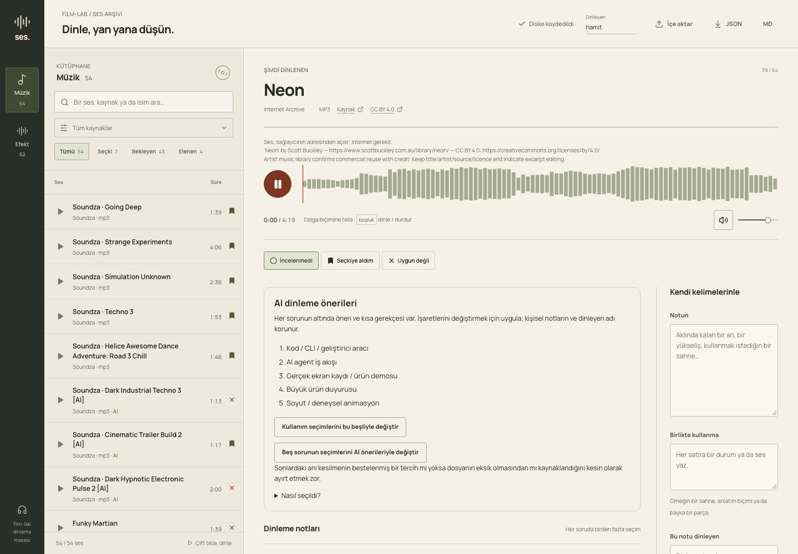
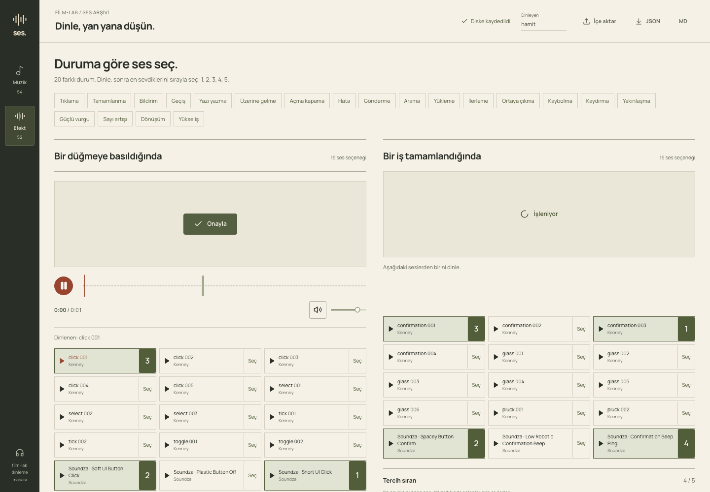

# Sound desk

A local review UI built with React, TanStack Router/Query/Table and Radix controls. Browse music, compare effects against 20 animated situations, rank up to five effects per situation and export notes as JSON or Markdown.

## Open the shared desk

From this directory, with Node 20.19+ or 22.12+:

```sh
npm ci
npm run setup
npm run build
npm start
```

Open `http://127.0.0.1:43791`. `npm run dev` runs the same local API with Vite middleware. The server only runs on your machine. No provider login or API key is needed to browse notes or play the included CC0 effects.

Setup copies the [shared snapshot](starter/README.md) into ignored `out/sound-review-studio/` once. It keeps an existing desk unchanged and refuses to overwrite a partial desk. Edits stay in your local copy; Git does not upload them. Export JSON to share new decisions.

The snapshot has 54 music entries and 52 effects. Forty Kenney effects are included under CC0; 44 music entries use their provider's public audio URL and need internet access. Twenty Soundza entries and two Scott Buckley tracks have source links only: their raw audio is not included. Their cards explain this and open the source page. Provider links can expire or be blocked; having an entry does not guarantee playback or approval for a film. Credits and licence links stay with each item.

Hamit's shared selections are one owner's preferences, not defaults for every customer. AI suggestions remain visibly separate from personal notes and approval status. See [the snapshot record](starter/README.md) for the exact export and limits.





[Clean-copy checks and known limits](checks/README.md).

## Existing local audio

`npm run prepare:audio` is optional and needs the older local listening page and downloaded audio. It is not part of clean setup. It can restore local playback for source-only entries when the files already exist; it does not fetch or publish sounds.

Preparation measures duration and a normalized 100-bar waveform with the repository's FFmpeg, with up to four decodes at once. It keeps absolute audio paths in private `out/sound-review-studio/audio-index.json`; the browser only receives whitelisted audio IDs. The 8 kHz signal is a listening-page overview, not a beat map or a full-band loudness measurement.

`catalogue.json` records the known provider and license fields. Missing license information stays unknown. `ai: true` means an explicit source flag; `false` does not prove human authorship.

The first preparation imports saved owner notes into `reviews.json`. Free-text notes, exclusions and listener names are kept; they do not become approvals. Later preparation leaves that file alone. Existing catalogue files and saved review documents get dated backups before replacement. Nothing prunes backups.

The API saves complete version-1 review documents. A save must include the current `revision`; stale saves return HTTP 409. Imports merge legacy music notes, saved effect choices or a full version-1 document with existing records. Export returns the complete saved document as JSON or a readable Markdown file. No browser localStorage is needed for persistence.

The server binds to loopback only and rejects foreign Host/Origin headers. It is a local personal tool, not an authenticated public service. Only one server process should write this data directory.

Passing automated checks does not approve the sound or its fit to a scene.

The effect view has 20 situation sections on one page. The original four remain: button press, completed task, new message and scene transition. New scenes cover typing, hover, toggle, error, sending, search, loading, progress, reveal, hide, movement, zoom, impact, counting, transformation and build-up. Each section has its own animation and candidate audition buttons. The separate selection button adds up to five sounds in click order, numbered 1–5. Clicking a selected number removes it and closes the gap; adding it again puts it last. A sixth choice is disabled, but listening stays available. Silence is a separate choice and clears the ranked sounds. Only one audio player is active. Auditioning does not save a preference.

Choices remain keyed by situation in the existing version-1 JSON document: `effect` holds rank 1, and optional `alternatives` holds ranks 2–5. Old single choices remain valid. Reasons and listener names stay when the ranking changes. JSON import/export keeps the order; Markdown lists every rank with its source. Duplicate sounds, more than five, sounds outside the situation and silence mixed with sounds are rejected.

`contexts.json` is shared by the app, catalogue preparation and server validation/export. New situations reuse the existing effect groups as audition candidates; these are not approved matches. Existing catalogues expand in memory without resetting saved reviews. Run `npm test` for mapping, isolated save/export and clean setup checks.

## AI music suggestions

Music reviews may include an optional `aiSuggestion` with a model, method, date and exactly five known launch-use labels. These are editable starting points, not listening approval. The desk displays them separately from the saved checkboxes. Applying the five changes only launch choices; notes, exclusions and other answers remain. JSON and Markdown exports keep the original AI suggestions even after a person edits the checkboxes. AI-seeded records stay unreviewed and have no human listener name. Existing human choices must not be replaced during a bulk import.

Suggestions can also contain `answers` for feeling, start, change and end. Each answer has up to three known `choices` and a short `reason`; an empty list means uncertain. The person can apply one question or all five questions. Uncertain answers leave existing selections alone. Optional `notes`, `avoid_with` and `caveat` stay separate from personal notes; the add buttons append without replacing existing text. Listener names and approval status never come from the model. Old launch-only records still work. JSON and Markdown keep both the AI answers and the person's choices.

This app displays saved suggestions. It does not send audio or API keys to a model. Generate recommendations in a separate local process, then save through the revision-checked API.
